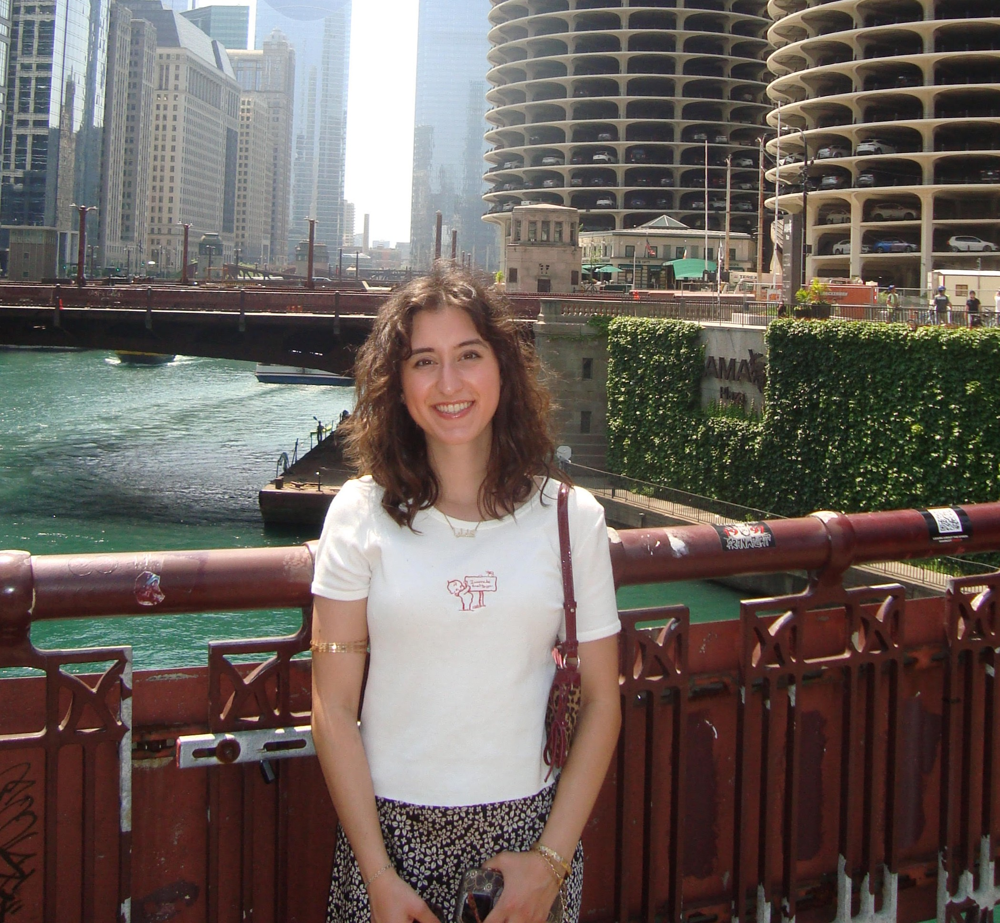

::: {style="text-align: center;"}

:::

------------------------------------------------------------------------

------------------------------------------------------------------------

::: {style="text-align: center;"}

<a href="https://www.linkedin.com/in/comelia-soltanirad"
target="_blank"
style="color:white; text-decoration:none;">
LinkedIn
</a>

:::

------------------------------------------------------------------------

Hi! My name is Comelia Soltanirad and I recently graduated from Case Western Reserve University with a Master’s degree in Epidemiology and Biostatistics, after earning my undergraduate degree in Chemistry from The Ohio State University.
My background has given me experience working across science, research, and data. During my graduate studies, I developed strong skills in data analysis, statistical modeling, and programming, using R, SAS, and Python to work with real-world datasets, build models, and communicate results.
I’m particularly interested in data analytics, data science, and informatics, and I enjoy using data to understand problems, identify patterns, and support better decision-making. I also have experience working with machine learning and AI, and I’m interested in opportunities where I can combine my quantitative background with newer technologies. I’m currently exploring opportunities in data analytics, data science, risk analysis, and related fields where I can continue learning and apply my technical and problem-solving skills.

If you’d like to connect, feel free to reach me at **comelias1617@gmail.com**, or connect with me on LinkedIn.
